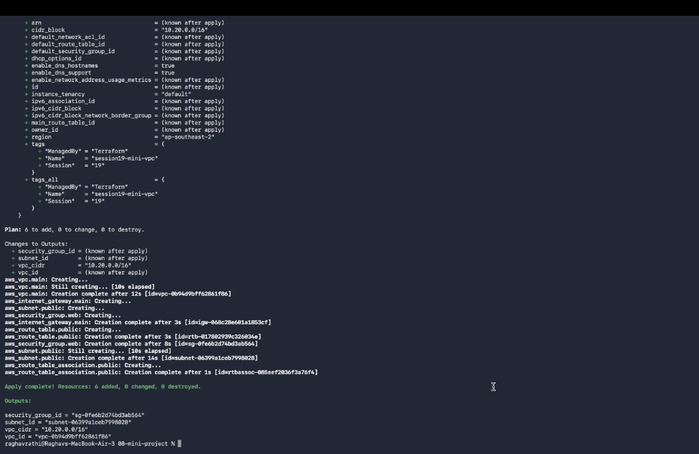
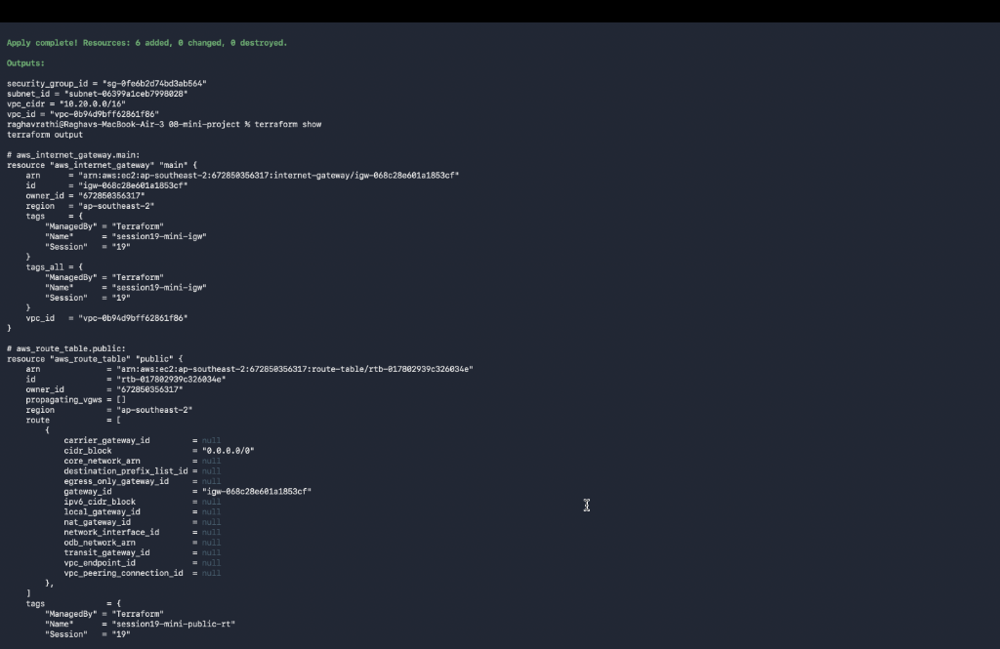
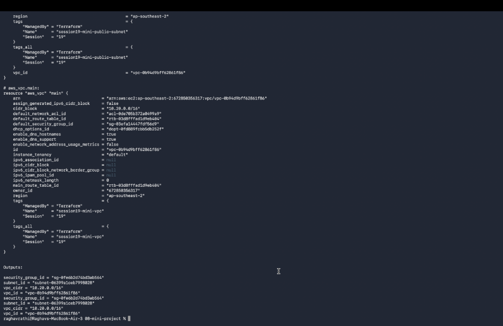
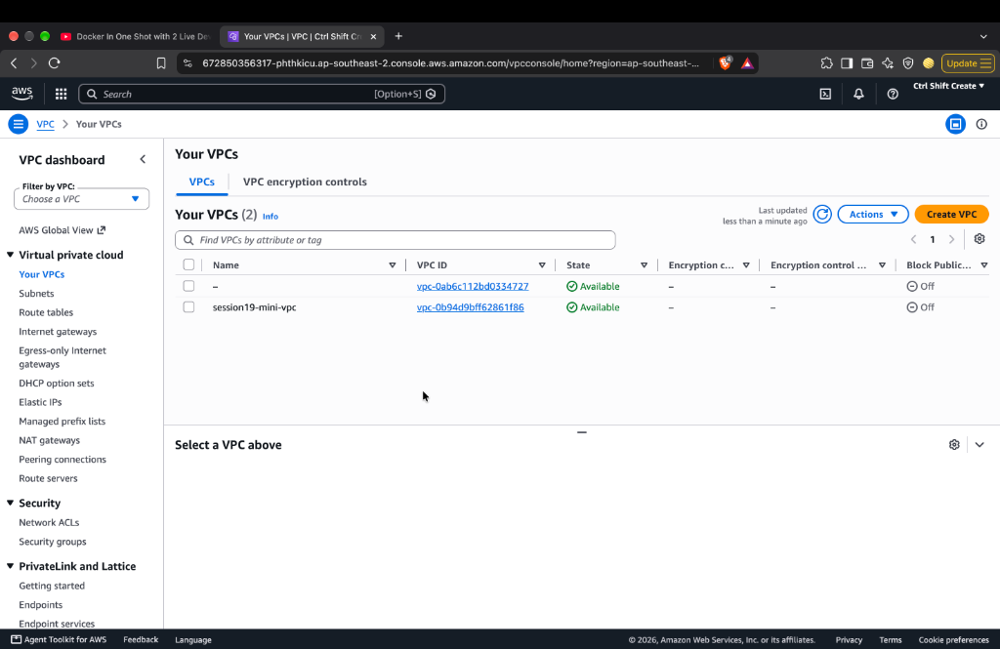

# Session 19: Cloud & Terraform in Action

## Task Overview
Build an end-to-end cloud infrastructure project using Terraform demonstrating providers, variables, resources, outputs, VPC, subnets, Internet Gateway, route tables, security groups, and state management.

---

## Architecture Diagram

```text
                        Internet
                           |
                           v
                  Internet Gateway (IGW)
                           |
                   +-------+-------+
                   |      VPC      |
                   |  10.20.0.0/16 |
                   |               |
                   |  Route Table  |
                   |       |       |
                   |       v       |
                   | Public Subnet |
                   | 10.20.1.0/24  |
                   |       |       |
                   | Security Group|
                   +---------------+
```

---

## Project Deliverables

- 📁 `08-mini-project/`
  - 📄 `main.tf` (VPC, Subnet, IGW, Route Table & Security Group resources)
  - 📄 `variables.tf` (Region, CIDR, Name tags variables)
  - 📄 `outputs.tf` (VPC ID, Subnet ID, Security Group ID)
  - 📄 `versions.tf` (Terraform & AWS Provider constraints)
  - 📄 `README.md` (Project execution guide)
- 🖼️ `screenshots/` (`01-terraform-vpc.png` & `02-cloud-infrastructure.png`)

---

## Terraform Execution Workflow

```bash
cd 08-mini-project
terraform init
terraform fmt
terraform validate
terraform plan
terraform apply -auto-approve
terraform show
terraform output
terraform destroy -auto-approve
```

---

## Live AWS & Terminal Verification Screenshots:
- **01. Terraform Apply Execution & 6 Resources Added**:
  
- **02. Terraform Show Resource State (IGW, Route Table, Subnet)**:
  
- **03. Terraform Show Resource State (VPC & Outputs)**:
  
- **04. AWS Management Console (Available VPC in Sydney Region)**:
  
